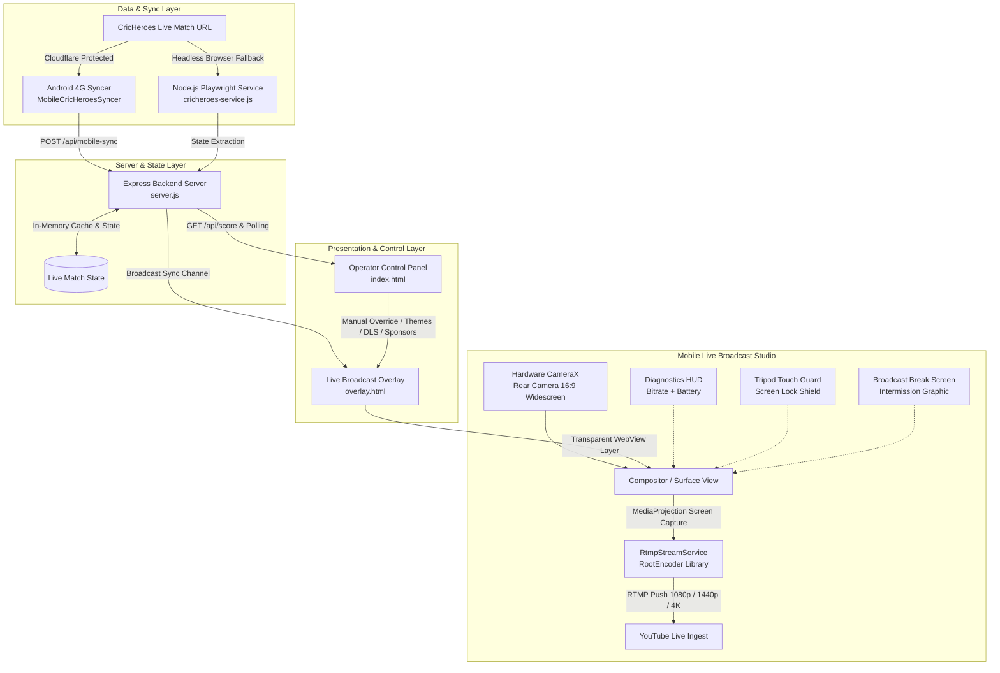

# CricLive — System Architecture & Functionality Document

## 1. Executive Summary

**CricLive** is a unified, end-to-end cricket live-scoring, broadcast overlay, and mobile video streaming platform. It connects real-time cricket scoring engines (primarily [CricHeroes](https://cricheroes.com)) with live video streams (YouTube Live via RTMP or OBS Studio) to deliver TV-quality broadcast graphics, manual scorer controls, and smartphone-based live video production.



---

## 2. Core Functional Modules

### 2.1 Backend Server & Sync Engine (`server.js`)

The backend is built with Node.js and Express in [`server.js`](file:///d:/CricketLive/CricLive/server.js) with support from [`cricheroes-service.js`](file:///d:/CricketLive/CricLive/cricheroes-service.js).

| Feature | Implementation | Description |
| :--- | :--- | :--- |
| **REST API Server** | Express.js (`PORT 3000`) | Provides REST endpoints for match score state, configuration, manual overrides, and debug telemetry. |
| **Canvas Scraping Engine** | [`cricheroes-service.js`](file:///d:/CricketLive/CricLive/cricheroes-service.js) | Hooks into `CanvasRenderingContext2D.prototype.fillText` within a persistent headless Chromium instance to extract live runs, balls, bowler statistics, and delivery bubbles drawn to HTML5 canvas. |
| **Mobile 4G Bypass Syncer** | [`MobileCricHeroesSyncer`](file:///d:/CricketLive/CricLive/android/app/src/main/kotlin/com/cktscoredemo/MainActivity.kt) | Bypasses Cloudflare anti-bot datacenter IP blocks by utilizing the mobile operator's 4G/5G cellular IP address inside an invisible Android WebView, pushing updates to `/api/mobile-sync`. |
| **Cross-Tab Synchronization** | `BroadcastChannel('ckt_score_sync')` | Propagates instantaneous updates between the operator control dashboard and broadcast overlays across browser tabs and WebViews without polling delay. |
| **Offline Asset Serving** | Express Static (`public/`) | Serves both the web control panel (`index.html`) and transparent overlay (`overlay.html`) with zero external CDN runtime dependencies. |

---

### 2.2 Operator Control Panel (`public/index.html`)

The control panel provides an intuitive dashboard for match producers, scorers, and ground commentators:

1. **Automated Match Sync**:
   - Single-click CricHeroes scorecard URL input.
   - Configurable polling intervals (2s, 4s, 5s, 10s, 15s).
   - Real-time connection indicators (Green = Connected, Amber = Stale, Red = Offline).

2. **Manual Scoring & Override Controls**:
   - Quick run increments (+1, +4, +6, Dot, Wicket, Extras).
   - Striker / Non-striker rotation and batter selection.
   - Bowler figures and current over delivery management.

3. **Innings & Chase Situations**:
   - *1st Innings*: Displays Current Run Rate (CRR) and Projected Score. Hides Target.
   - *2nd Innings*: Automatically calculates Target, Required Run Rate (RRR), and ball-by-ball equation ("Need X runs off Y balls").

4. **Rain Interruption & DLS Target Support**:
   - Dedicated field to input DLS revised targets.
   - When set, automatically updates the overlay to show `TARGET (DLS)` and revised chase equations.

5. **Commercial Partner & Sponsor Management**:
   - Comma-separated sponsor input field (e.g. *"Title Sponsor: ABC Motors, Powered By: XYZ Sports"*).
   - Propagates sponsor rotations directly to the broadcast scorebar.

6. **Visual & Theme Customization**:
   - Preset themes (Electric Blue, Blue/Gold Professional, Minimal Dark).
   - Team color picker with live HEX swatch preview.
   - Background opacity slider (50% to 100%) and layout toggles.

---

### 2.3 Live Broadcast Overlay Engine (`public/overlay.html`)

Designed for transparent chroma/alpha mixing in OBS Studio, vMix, or inside the native mobile app:

1. **Slender Top Ribbon**:
   - Tournament trophy icon, championship title, venue name.
   - Dynamic 1st/2nd Innings badge (`chase-active`).
   - Stale data alert pill (`⚠️ DELAYED`) if live score stops updating.
   - Rotating sponsor marquee slot (`🤝 Partner`).

2. **Hero Score Hub**:
   - High-contrast, tabular-numeral runs and wickets (`128/3`).
   - Overs indicator in cyan accent (`15.2 OV`).
   - Equation pills: CRR, Projected total, Target (`TARGET (DLS)` when applicable), and live chase ticker.
   - Sponsor pill (`PARTNER: [Name]`) cycling every 12 seconds with fade animation.

3. **Docked Player Stats Bar**:
   - **Batters Box**: Active striker indicated with arrow (`▶`) and asterisk (`*`), runs, balls, 4s, 6s, and calculated Strike Rate.
   - **Bowler Box**: Bowler name, overs bowled, maidens, runs conceded, wickets taken, and economy rate.
   - **This Over Deliveries**: Color-coded delivery bubbles:
     - Dot ball: Dark subtle pill (`•`)
     - Four: Vibrant green gradient with glow (`4`)
     - Six: Golden amber gradient with glow (`6`)
     - Wicket: Crimson red pill (`W`)

4. **Operator Overlay Toolbar (Docked Left)**:
   - Discreet floating gear button (`⚙`) on top-left (`top: 10px; left: 10px`).
   - Layout modes: **Slim Bar** (minimal lower-third) vs **Full** (complete match card).
   - Scale selector: **78%** (default non-obstructive) and **90%** (large television broadcast).
   - Position toggle: Instantly shifts overlay between **Bottom** and **Top** of screen.

---

### 2.4 Android Mobile Broadcast Studio (`MainActivity.kt` & `RtmpStreamService.kt`)

Transforms an Android smartphone into a complete, standalone live cricket broadcasting unit:

#### 1. Hardware Camera & Fullscreen Composition
- **Rear Camera Lock**: Permanently locked to the high-resolution rear lens (`CameraSelector.LENS_FACING_BACK`) for tripod stability.
- **16:9 Broadcast Aspect Ratio**: Locked CameraX preview pipeline (`AspectRatio.RATIO_16_9`) with `ScaleType.FILL_CENTER` matching YouTube Live widescreen.
- **Edge-to-Edge Display Cutout Integration**: Configured with `LAYOUT_IN_DISPLAY_CUTOUT_MODE_SHORT_EDGES` and `setDecorFitsSystemWindows(window, false)` to eliminate black pillarbox bars on notched displays.
- **Camera Zoom Controls**: Smooth pinch-to-zoom and thumb-friendly vertical zoom bar with quick presets (1x, 2x, 4x, 8x).
- **Flashlight / Torch**: One-tap toggle for night matches or low-light evening conditions.

#### 2. YouTube Live RTMP Ingestion Engine
- **Hardware-Accelerated Service**: Uses RootEncoder (`RtmpDisplay`) to mix the CameraX surface, web overlay, and microphone into H.264 video + AAC audio.
- **Standardized RTMP Endpoint**: Default `rtmp://a.rtmp.youtube.com/live2` without forced port 443 or TLS substitution.
- **Resolution & Bitrate Profiles**:
  | Quality Profile | Resolution | Bitrate | FPS | Recommended Network |
  | :--- | :--- | :--- | :--- | :--- |
  | **1080p FHD** | 1920 × 1080 | 5,000 Kbps | 30 | Standard 4G LTE |
  | **1440p QHD** | 2560 × 1440 | 9,000 Kbps | 30 | High-speed 4G / 5G |
  | **2160p 4K** | 3840 × 2160 | 18,000 Kbps | 30 | High-capacity 5G / Fiber Wi-Fi |

#### 3. Broadcast Resilience & Operator Ergonomics
- **Automatic Reconnection (4G Resilience)**: Up to 5 automatic retry attempts with exponential backoff (2s, 4s, 6s, 8s) upon network dips or cell tower handoffs.
- **Tripod Touch Guard / Screen Lock Mode**: Dedicated `🔒 Lock` button activates an invisible input shield preventing accidental touches from tripod clamps, sweat, or rain. Tap-to-unlock overlay banner.
- **Live Stream Health Diagnostics HUD**: Real-time throughput bitrate gauge (`5.2M` / `850k`) and device battery percentage (`🔋84%`) displayed directly in the top status pill.
- **Privacy Shield / Break Screen**: One-tap `⏸ Break` toggle replaces live camera feed with an intermission graphic (*"INNINGS BREAK / TECHNICAL PAUSE"*) so operators can adjust equipment or check phone messages without live broadcast leaks.

---

## 3. Data Dictionary: Live Match State Schema

```json
{
  "batting_team": "CARAVAN CLUB",
  "bowling_team": "CENTURY CC",
  "score": "128/3",
  "overs": "15.2",
  "totalOvers": 20,
  "crr": "8.35",
  "projected": "167",
  "target": 182,
  "dlsTarget": 142,
  "dlsApplied": false,
  "chase": "Need 54 off 28b",
  "tournament": "IISC Champions League – ICL 2026",
  "venue": "Gymkhana Ground, Bengaluru",
  "sponsors": "Title Sponsor: ABC Motors, Powered By: XYZ Sports",
  "status": "LIVE",
  "currentInnings": 2,
  "batters": [
    {
      "name": "Rahul Sharma",
      "runs": 48,
      "balls": 32,
      "fours": 5,
      "sixes": 2,
      "strikeRate": "150.0",
      "striker": true
    },
    {
      "name": "Arun Kumar",
      "runs": 22,
      "balls": 18,
      "fours": 2,
      "sixes": 0,
      "strikeRate": "122.2",
      "striker": false
    }
  ],
  "bowler": {
    "name": "Vikram Sen",
    "overs": "3.2",
    "maidens": 0,
    "runs": 26,
    "wickets": 2,
    "eco": "7.80"
  },
  "this_over": ["1", "4", "•", "2", "6", "W"],
  "isStale": false
}
```

---

## 4. API Specification

| Endpoint | Method | Payload / Params | Description |
| :--- | :--- | :--- | :--- |
| `/api/score` | `GET` | None | Returns normalized match state JSON for overlay and control panels. |
| `/api/update` | `POST` | `matchState` partial object | Updates match score, batters, bowler, or situation manually. |
| `/api/mobile-sync` | `POST` | Extracted CricHeroes state | Receives mobile-extracted data from Android 4G syncer. |
| `/api/config` | `POST` | `{ matchUrl, tournament, venue, totalOvers, currentInnings }` | Sets active match configuration and scraper target URL. |
| `/api/overlay-settings` | `POST` | Theme, layout, colors, opacity | Updates overlay presentation styles across all active clients. |
| `/health` | `GET` | None | Returns server health status and process uptime. |

---

## 5. Operational Workflows

### 5.1 Mobile Ground Broadcast (Single Android Phone)
1. Install [CricLive.apk](file:///d:/CricketLive/CricLive/CricLive.apk) on the broadcasting smartphone.
2. Open the app, tap **📱 4G Sync**, and paste the CricHeroes match URL.
3. Tap **📹 Live Cam** to enter landscape broadcast mode.
4. Tap **🔴 Stream to YouTube**, enter YouTube Stream Key, select resolution (**1080p**, **1440p**, or **2160p**), and start streaming.
5. Tap **🔒 Lock** to activate Tripod Touch Guard once the phone is clamped onto the tripod.
6. During breaks, tap **⏸ Break** to display the intermission screen while adjusting equipment.

### 5.2 Studio / OBS Production Setup
1. Launch the server using `npm start`.
2. Open [`http://localhost:3000`](http://localhost:3000) for operator controls.
3. In OBS Studio or vMix, create a **Browser Source** pointing to `http://localhost:3000/overlay.html`.
4. Set dimensions to `1920x1080` with background transparency enabled.
5. Overlay updates automatically via `BroadcastChannel` and polling.
