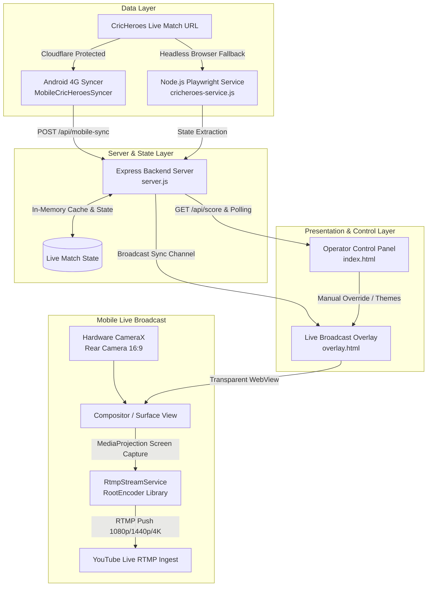

# CricLive — System Architecture & Functionality Document

## 1. Executive Summary

**CricLive** is an end-to-end live cricket scoring, broadcast overlay, and mobile streaming ecosystem. It bridges live cricket scoring platforms (primarily [CricHeroes](https://cricheroes.com)) with live video streams (YouTube Live via RTMP/OBS) and provides real-time broadcast graphics, manual operator controls, and mobile camera mixing.



---

## 2. Core Functional Modules

### 2.1 Backend & CricHeroes Sync Engine

The backend is built with Node.js and Express in [`server.js`](file:///d:/CricketLive/CricLive/server.js) supported by [`cricheroes-service.js`](file:///d:/CricketLive/CricLive/cricheroes-service.js).

| Feature | Implementation | Description |
| :--- | :--- | :--- |
| **Canvas Scraping Engine** | [`cricheroes-service.js`](file:///d:/CricketLive/CricLive/cricheroes-service.js) | Injects hooks into `CanvasRenderingContext2D.prototype.fillText` to extract live scores, run counts, overs, and ball tracking drawn to HTML5 canvas. |
| **Mobile 4G Bypass Syncer** | [`MobileCricHeroesSyncer`](file:///d:/CricketLive/CricLive/android/app/src/main/kotlin/com/cktscoredemo/MainActivity.kt) | Bypasses Cloudflare datacenter IP blocks by leveraging the user's mobile cellular connection on Android to extract DOM/canvas state and push it to `/api/mobile-sync`. |
| **Live State REST API** | `/api/score` & `/api/update` | Exposes normalized match state (teams, score, overs, CRR, projected score, target, batters, bowler, delivery bubbles, tournament). |
| **Cross-Tab Synchronization** | `BroadcastChannel('ckt_score_sync')` | Propagates instantaneous updates between the operator control dashboard and broadcast overlays across browser tabs and WebViews. |

---

### 2.2 Operator Control Panel ([`public/index.html`](file:///d:/CricketLive/CricLive/public/index.html))

The control panel provides a dashboard for match operators, scorers, and producers:

- **Automated Score Sync**: One-click CricHeroes match URL input with automated live polling intervals.
- **Manual Score Adjustments**: Manual score increments (+1, +4, +6, Wicket, Extras), batter strike toggles, and bowler overs management.
- **Innings Logic**:
  - *1st Innings*: Shows Current Run Rate (CRR) and Projected Score. Hides Target and Chase equation.
  - *2nd Innings*: Automatically computes and displays Target, Required Run Rate (RRR), and ball-by-ball chase status.
- **Branding & Visual Customization**: Team name editors, custom team colors (primary/secondary), tournament title, venue, and overlay opacity.

---

### 2.3 Live Broadcast Overlay ([`public/overlay.html`](file:///d:/CricketLive/CricLive/public/overlay.html))

Designed for transparent chroma/alpha mixing in OBS Studio or mobile camera broadcasting.

#### UI Elements:
1. **Slender Top Ribbon**: Displays trophy icon, tournament title, venue name, 1st/2nd Innings badge, and compact live status indicator.
2. **Hero Score Hub**: High-contrast runs/wickets display, overs counter, CRR, Projected score, and Chase equation banner.
3. **Docked Player Stats Bar**:
   - Striker / Non-striker indicators (`*`), player runs, balls faced, 4s, 6s, and Strike Rate.
   - Active bowler figures: overs, maidens, runs conceded, wickets, and economy rate.
   - This Over delivery bubbles: Color-coded pills for dots (`•`), boundaries (`4` green, `6` purple), and wickets (`W` red).
4. **Dynamic Event Pop-Up Banners**: Animated overlays triggered on boundaries (4/6), milestones (50/100), and wickets.

#### Floating Operator Controls (Left Side):
- **Gear Setting Icon (`⚙`)**: Docked on the left side (`top: 10px; left: 10px`), opens the overlay toolbar on demand.
- **Size Options**: Toggle between **Slim Bar** (compact layout for mobile/lower thirds) and **Full** (complete match card).
- **Scale Selector**: Dropdown selector (`<select id="scaleSelect">`) with direct quick toggles for **78%** (default) and **90%** (large).
- **Position Toggle**: Shifts overlay docking between **Bottom** and **Top** of the screen.

---

### 2.4 Android Mobile Broadcast Application ([`MainActivity.kt`](file:///d:/CricketLive/CricLive/android/app/src/main/kotlin/com/cktscoredemo/MainActivity.kt))

The Android app transforms any Android phone into a portable cricket broadcast studio:

#### 1. Hardware Camera & Fullscreen Composition
- **Rear Camera Lock**: Uses `CameraSelector.LENS_FACING_BACK` with continuous auto-focus.
- **16:9 Aspect Ratio**: Locked CameraX preview pipeline (`AspectRatio.RATIO_16_9`) with `ScaleType.FILL_CENTER` matching standard broadcast standards.
- **Edge-to-Edge Cutout Support**: Configured with `LAYOUT_IN_DISPLAY_CUTOUT_MODE_SHORT_EDGES` and `setDecorFitsSystemWindows(window, false)` to prevent black letterbox borders around display notches and camera cutouts.
- **Camera Controls**: Pinch-to-zoom and floating vertical zoom bar supporting 1x, 2x, 4x presets up to 8x digital zoom.

#### 2. YouTube Live RTMP Ingestion ([`RtmpStreamService.kt`](file:///d:/CricketLive/CricLive/android/app/src/main/kotlin/com/cktscoredemo/RtmpStreamService.kt))
- **Foreground Streaming Service**: High-performance screen-capture and microphone-mixing service powered by the RootEncoder library (`RtmpDisplay`).
- **Endpoint Configuration**:
  - Default RTMP endpoint: `rtmp://a.rtmp.youtube.com/live2` (no port 443 required).
  - Sanitization logic preserves raw `rtmp://` endpoints without forcing encryption or port substitution.
- **Resolution & Bitrate Profiles**:
  | Profile | Dimensions | Bitrate | Framerate |
  | :--- | :--- | :--- | :--- |
  | **1080p FHD** | 1920 × 1080 | 5,000 Kbps | 30 FPS |
  | **1440p QHD** | 2560 × 1440 | 9,000 Kbps | 30 FPS |
  | **2160p 4K** | 3840 × 2160 | 18,000 Kbps | 30 FPS |
- **Audio Mixing**: Optional commentary audio toggle mixing the phone microphone at 128 kbps 44.1 kHz AAC.
- **Status HUD**: Ultra-compact top bar displaying `LIVE` indicator, elapsed broadcast duration timer, and connection progress.

---

## 3. Data Dictionary: Live Match State Object

```json
{
  "batting_team": "CARAVAN CLUB",
  "bowling_team": "CENTURY CC",
  "score": "128/3",
  "overs": "15.2",
  "crr": "8.35",
  "projected": "167",
  "target": 182,
  "chase": "Need 54 off 28b",
  "tournament": "IISC Champions League 2026",
  "venue": "Gymkhana Ground, Bengaluru",
  "status": "LIVE",
  "currentInnings": 2,
  "batters": [
    { "name": "Rahul Sharma", "runs": 48, "balls": 32, "fours": 5, "sixes": 2, "strikeRate": "150.0", "striker": true },
    { "name": "Arun Kumar", "runs": 22, "balls": 18, "fours": 2, "sixes": 0, "strikeRate": "122.2", "striker": false }
  ],
  "bowler": {
    "name": "Vikram Sen", "overs": "3.2", "maidens": 0, "runs": 26, "wickets": 2, "eco": "7.80"
  },
  "this_over": ["1", "4", "0", "2", "6", "1"]
}
```

---

## 4. Operational Workflows

### 4.1 Match Day Setup (Mobile Only)
1. Install [CricLive.apk](file:///d:/CricketLive/CricLive/CricLive.apk) on the broadcasting Android smartphone.
2. Launch the app and tap **📱 4G Sync** to input the CricHeroes live scorecard link.
3. Tap **📹 Live Cam** to enter landscape broadcast mode.
4. Tap **🔴 Stream to YouTube**, enter your YouTube Stream Key, select resolution (**1080p FHD**, **1440p QHD**, or **2160p 4K**), and tap **Start YouTube Stream**.
5. The mixed video feed with transparent live scores will broadcast directly to your YouTube channel.

### 4.2 Match Day Setup (Studio / OBS Production)
1. Start the Node.js server with `npm start`.
2. Open [`http://localhost:3000`](http://localhost:3000) for operator controls.
3. In OBS Studio, add a **Browser Source** pointing to `http://localhost:3000/overlay.html`.
4. Set OBS Browser Source resolution to `1920x1080` and enable transparency.
